# Surface EMG-Based Hand Movement Recognition and Virtual Robotic Hand Teleoperation

[](https://docs.ros.org/en/humble/)
[](https://classic.gazebosim.org/)
[](https://www.python.org/)
[](https://docs.arduino.cc/hardware/due)
[](https://www.kicad.org/)
[](https://scikit-learn.org/)
[](https://developers.google.com/edge/mediapipe/solutions/vision/hand_landmarker)

An end-to-end cyber-physical pipeline integrating **surface electromyography (sEMG)** bio-signal acquisition, automated **computer vision ground-truth labelling**, **machine learning classification** (evaluating 21 feature-classifier combinations across sets A–G with LDA, SVM, and KNN), and real-time low-latency teleoperation of a 17-DOF **InMoov humanoid robotic hand** in **ROS 2 Humble** and **Gazebo Classic**.

---

## Table of Contents
1. [System Architecture & Dataflow](#1-system-architecture--dataflow)
2. [Hardware Devices & Sensor Configuration](#2-hardware-devices--sensor-configuration)
3. [Custom 6-Channel sEMG Acquisition Hardware (ADS1296)](#3-custom-6-channel-semg-acquisition-hardware-ads1296)
4. [Interactive Graphical User Interface (GUI) Walkthrough](#4-interactive-graphical-user-interface-gui-walkthrough)
5. [Signal Processing, Feature Sets (A to G) & ML Models](#5-signal-processing-feature-sets-a-to-g--ml-models)
6. [ROS 2 & Gazebo Virtual Robotic Hand Simulation](#6-ros-2--gazebo-virtual-robotic-hand-simulation)
7. [Experimental Results & Benchmark Performance](#7-experimental-results--benchmark-performance)
   - [Master Benchmark Evaluation Table](#master-benchmark-evaluation-table)
   - [Waveform Characteristics (All 8 Gestures)](#waveform-characteristics)
   - [Training Results & Graphical Representations (`results/training_results/`)](#-training-results--graphical-representations-directory)
8. [Step-by-Step Guide: How to Make It Work](#8-step-by-step-guide-how-to-make-it-work)
9. [Relative Repositories, Documentation & References](#9-relative-repositories-documentation--references)

---

## 1. System Architecture & Dataflow

The system bridges biological neuromuscular intent to virtual robotic actuation through a synchronized multi-stage pipeline:

```mermaid
flowchart LR
    A["Forearm Muscle Flexion"] --> B["sEMG Electrodes + BioAmp Shield"]
    B --> C["Arduino Due (2 kHz 12-bit ADC)"]
    C -->|"Binary Stream: EMG1 Packet + CRC32"| D["Windows Desktop GUI Application"]
    E["Monocular RGB Webcam"] -->|"MediaPipe Hand Landmarker"| D
    D --> F["Windowing (250 ms, 50 ms hop)<br/>Feature Extraction (Sets A–G)"]
    F --> G["Classifier Inference<br/>(LDA / SVM / KNN)"]
    G --> H["Majority Vote & Rejection Gate<br/>(Threshold >= 60%)"]
    H -->|"TCP Socket (localhost:9996)"| I["WSL 2: ros2_gazebo_server"]
    I -->|"/finger_position_controller/commands"| J["Gazebo: InMoov 17-DOF Hand"]
```

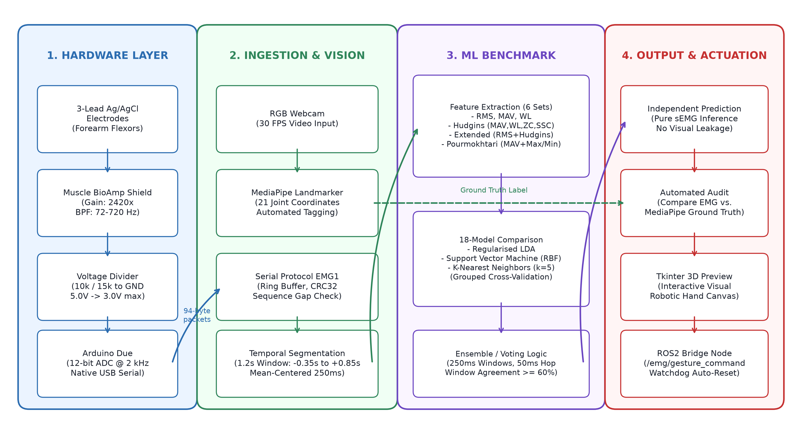

1. **Neuromuscular Sensing**: Surface electrical potentials generated during muscle contractions on the forearm are captured by Ag/AgCl differential electrodes.
2. **Signal Conditioning & Digitization**: The analogue signal is band-pass filtered (72–720 Hz) and amplified by an Upside Down Labs Muscle BioAmp Shield v0.3, then sampled by an Arduino Due 12-bit ADC at a continuous **2,000 Hz**.
3. **High-Speed Serial Streaming**: Data is packed into custom framed binary packets (`EMG1` protocol, 26-byte header, 32-sample payload, CRC32 checksum) and sent via Native USB serial to the Windows host.
4. **Automated Vision-Guided Labeling**: A synchronized camera feed processes hand gestures using Google MediaPipe Hand Landmarker, computing 3D geometric finger joint angles to generate objective reference labels during training.
5. **Feature Extraction & Multi-Model Inference**: Overlapping 250 ms windows (50 ms hop) extract time-domain and time-frequency spectral features (Sets A through G). Predictions are computed across Linear Discriminant Analysis (LDA), Support Vector Machine (SVM), and K-Nearest Neighbors (KNN).
6. **Cross-Platform Teleoperation Bridge**: Accepted gesture commands are transmitted over a high-speed TCP socket (`localhost:9996`) to a ROS 2 bridge node running inside WSL 2 Ubuntu 22.04.
7. **Virtual Actuation**: The ROS 2 bridge node translates gesture tokens into 17 target joint angles published to `/finger_position_controller/commands`, driving the simulated InMoov robotic hand in Gazebo Classic in real time.

---

## 2. Hardware Devices & Sensor Configuration

### Single-Channel Benchmarking Platform
* **Microcontroller**: Arduino Due featuring an Atmel/Microchip SAM3X8E 32-bit ARM Cortex-M3 processor clocked at 84 MHz.
  * Internal 12-bit Analog-to-Digital Converter (`0–4095` counts).
  * Hardware timer interrupt-driven sampling at exact 2,000 samples/second.
  * Native USB CDC communication at full bus speed (exceeding standard 115200 baud UART bandwidth constraints).
* **Bio-Potential Amplifier**: Upside Down Labs Muscle BioAmp Shield v0.3.
  * Analogue front-end instrumentation amplifier with differential gain $A_v \approx 1000$.
  * Analogue bandpass filter: $72\text{ Hz} - 720\text{ Hz}$.
  * Power supply: 5.0 V rail derived from Arduino Due 5V pin.
* **Safety & Voltage Conditioning**:
  * **Critical Electrical Constraint**: The Arduino Due SAM3X8E ADC pin A0 is strictly 3.3 V tolerant (`0 – 3.3 V`). Feeding raw 5 V output from the shield risks permanent pin damage.
  * A passive voltage divider and protection network ensures voltage peaks never exceed the 3.3 V threshold under full muscle contraction.
* **Electrodes**:
  * Standard clinical disposable Ag/AgCl hydrogel pre-gelled surface electrodes (24 mm diameter).
  * Placed in a bipolar arrangement along the muscle belly of the *Flexor Digitorum Superficialis* (FDS) and *Flexor Carpi Radialis* (FCR) on the anterior forearm.
  * Ground / reference electrode placed on a neutral bony landmark: the olecranon process of the elbow.

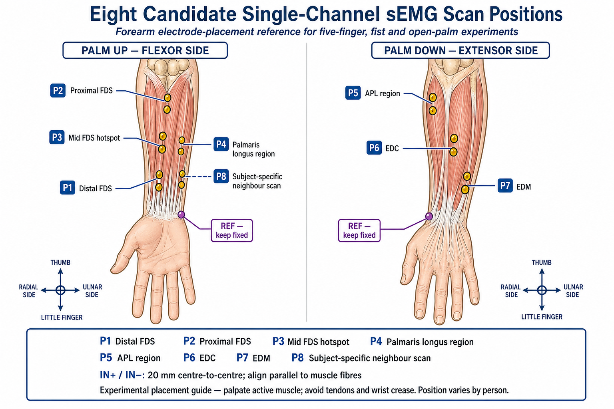

---

## 3. Custom 6-Channel sEMG Acquisition Hardware (ADS1296)

To scale from single-channel discrimination to simultaneous multi-finger gesture decoding, a dedicated **6-channel bio-potential acquisition carrier board** was designed in KiCad.

### Key Architectural Specifications
* **Analog Front-End (AFE)**: Texas Instruments **ADS1296** (6-channel, 24-bit simultaneous sampling delta-sigma ADC with programmable gain amplifiers, PGA = 1 to 12).
* **Sampling Throughput**: Target 4,000 samples/second per channel across 6 simultaneous differential channels (24-bit frame = 21 bytes per sample, 84 kB/s raw stream).
* **Host Controller**: Removable **Waveshare ESP32-S3-Tiny** dual-core Xtensa LX7 MCU mounted via dual 1x9 female header sockets (2.54 mm pitch, 15.24 mm row spacing).
* **Board Dimensions**: 100 mm x 80 mm, 4-layer FR4 stackup, 1.6 mm thickness.
* **Power Supply**:
  * Battery branch input: 5.0 V regulated via J1.
  * Analog rail: Texas Instruments **LP5907** ultra-low-noise 3.0 V linear regulator (sub-10 µV RMS output noise, 250 mA rating).
  * Digital rail: 3.3 V supplied by the ESP32-S3 module.

### PCB Layer Stackup
| Layer | Name | Type | Description |
|:---:|:---|:---:|:---|
| **L1** | F.Cu | Top Signal | Surface-mount components (109 footprints), high-frequency SPI bus, RF antenna keepout |
| **L2** | In1.Cu | Ground Plane | Solid, uninterrupted GND reference return plane across entire board |
| **L3** | In2.Cu | Power Plane | Clean analog AVDD (3.0 V) copper pour, isolated digital power routing |
| **L4** | B.Cu | Bottom Signal | Critical return paths, plus underside decoupling capacitors (C14, C27, R21, C23) |

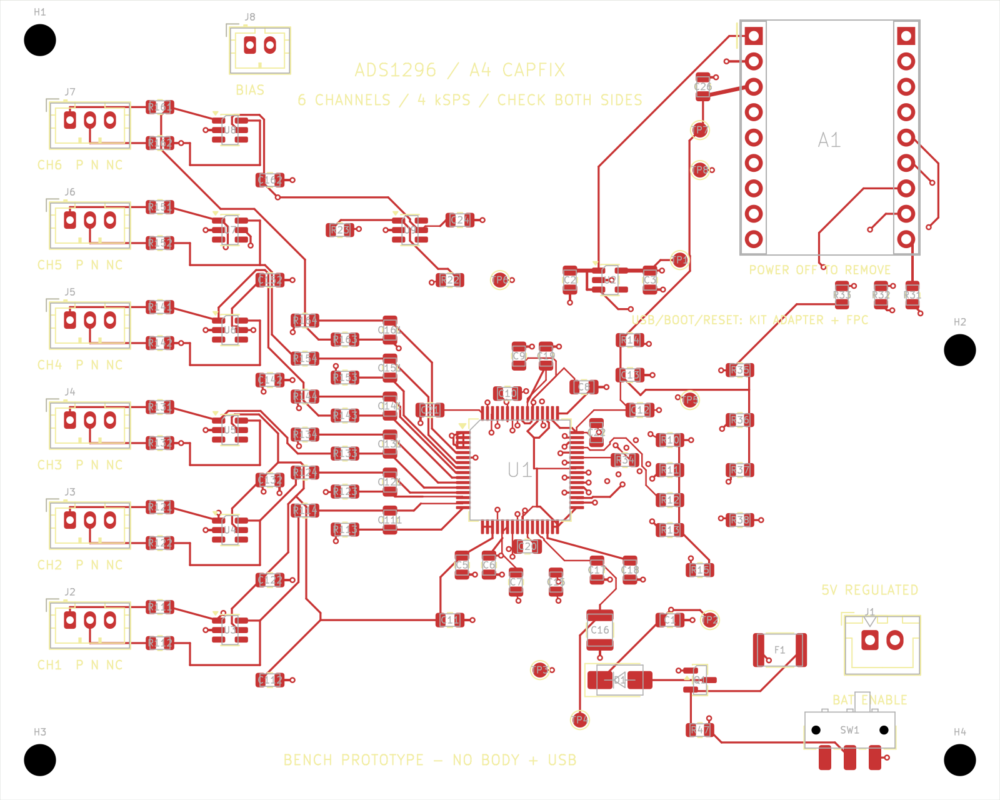
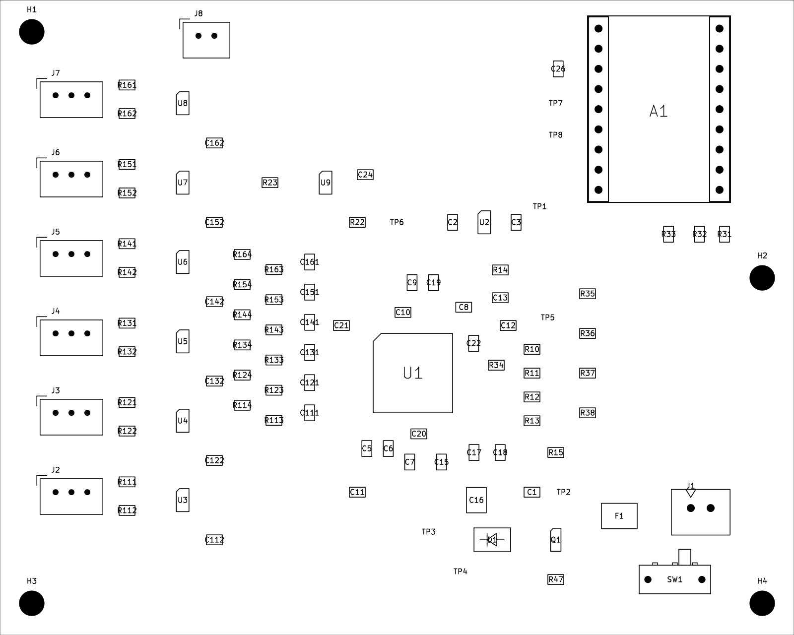

### Hierarchical Schematic Architecture

The KiCad project is structured across seven modular hierarchical sheets:

#### Sheet 01: Root Hierarchical Architecture
Orchestrates global inter-sheet busses, power rails, differential analog input channels, SPI command lines, and ground isolation.
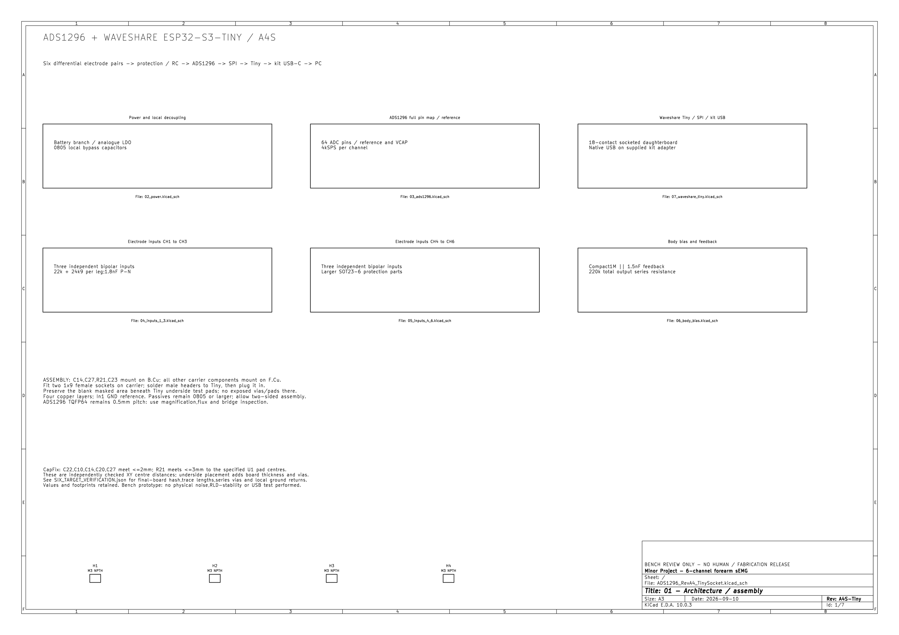

#### Sheet 02: Power Management & Low-Noise Decoupling
Houses the TI LP5907 3.0V low-dropout regulator, bulk input tantalum capacitors, LC filter beads, and localized ceramic decoupling capacitors ($10\text{ }\mu\text{F} \parallel 0.1\text{ }\mu\text{F}$) positioned immediately adjacent to power pins.
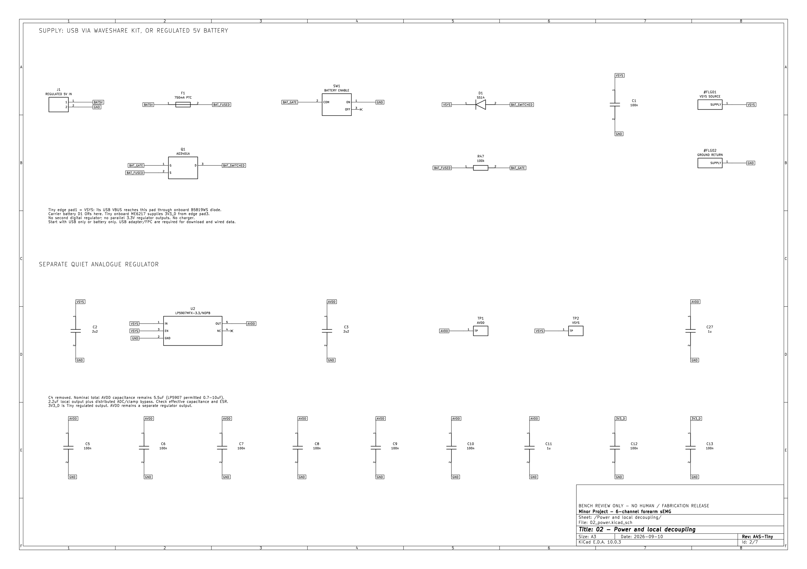

#### Sheet 03: ADS1296 Bio-Potential Core & Pin Mapping
Contains the central 64-pin TQFP ADS1296 analog front-end, internal reference generation ($V_{REF} = 2.42\text{ V}$), charge pump decoupling (VCAP1, VCAP2, VCAP3, VCAP4), clock oscillators, and digital SPI lines.
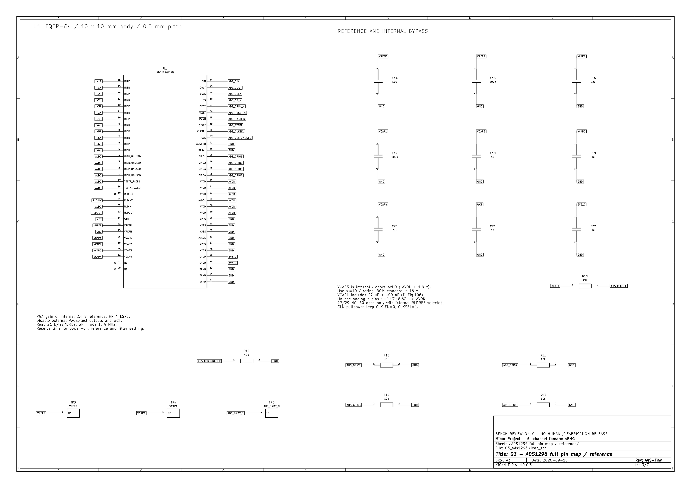

#### Sheets 04 & 05: Electrode Input Protection & Anti-Aliasing (CH1–CH3 & CH4–CH6)
Provides identical differential input conditioning for all 6 channels:
* Differential low-pass filter: $R_{in1} = 22\text{ k}\Omega$, $R_{in2} = 24.9\text{ k}\Omega$, $C_{diff} = 1.8\text{ nF}$ (differential cut-off frequency $f_c \approx 942.6\text{ Hz}$).
* Common-mode RF filtering: $C_{cm} = 47\text{ pF}$ to analog ground.
* Transient overvoltage clamping: Texas Instruments **TPD4E001** 4-channel low-capacitance ESD protection diode arrays.
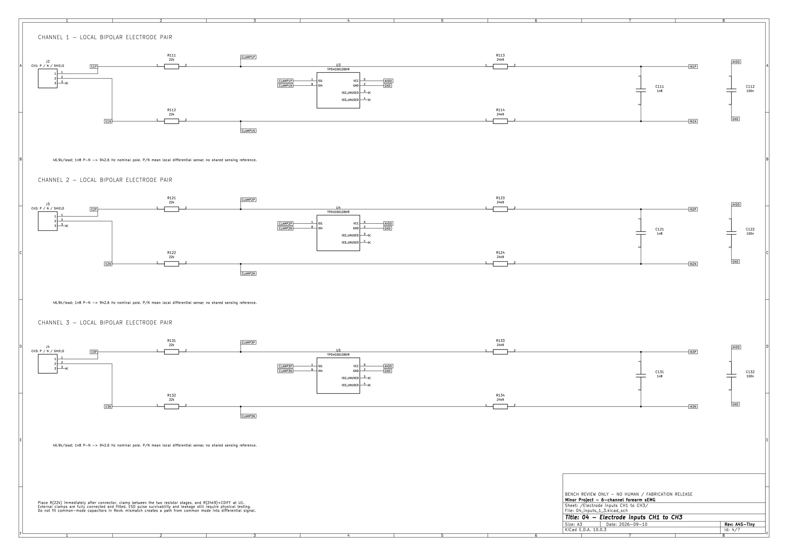
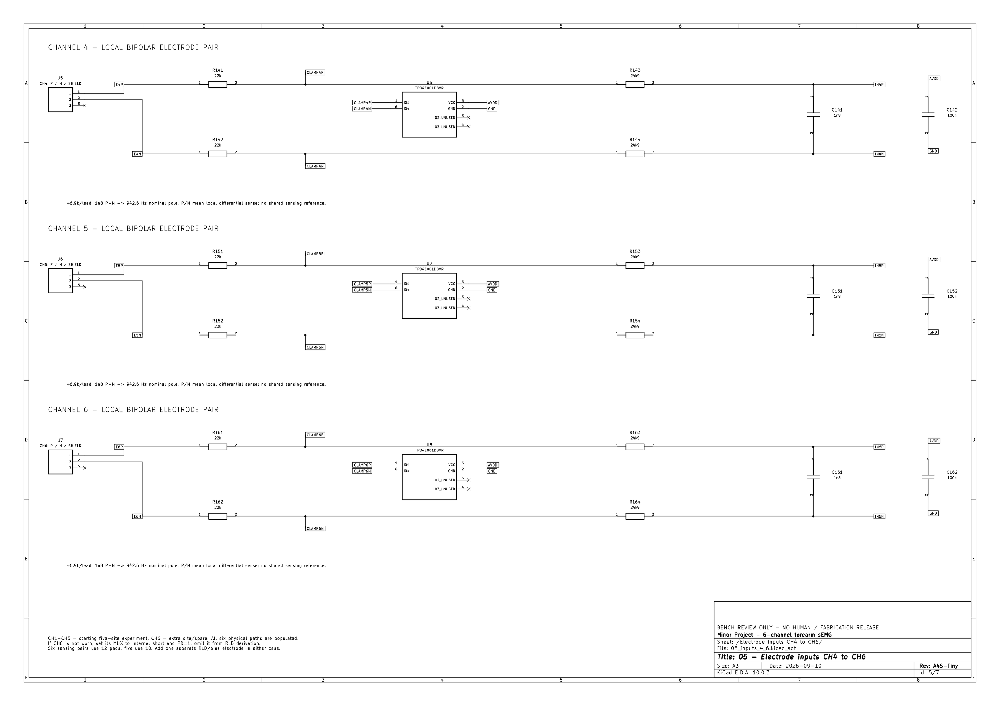

#### Sheet 06: Active Body Bias & Driven-Right-Leg (RLD) Feedback
Features an inverting operational amplifier circuit deriving the common-mode potential from selected channel inputs, inverting it, and actively driving it back to the body via a dedicated reference electrode (J8). This dynamically suppresses 50 Hz/60 Hz mains interference.
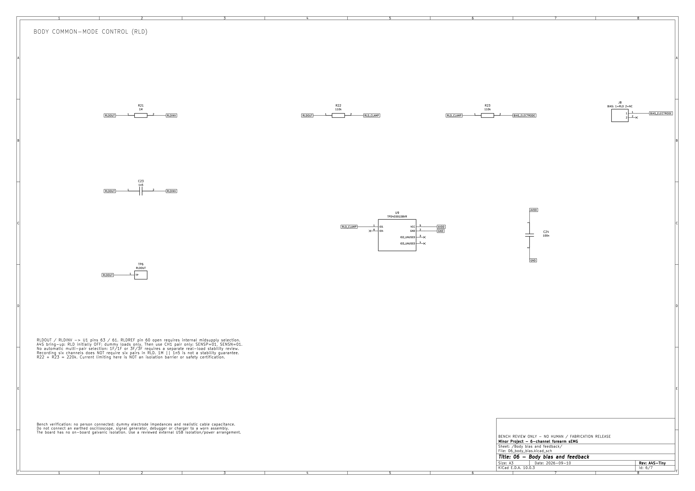

#### Sheet 07: Waveshare ESP32-S3-Tiny Carrier Socket & SPI Interface
Defines the dual 1x9 socket interface mapping the ESP32-S3 GPIO pins to the ADS1296 SPI lines.
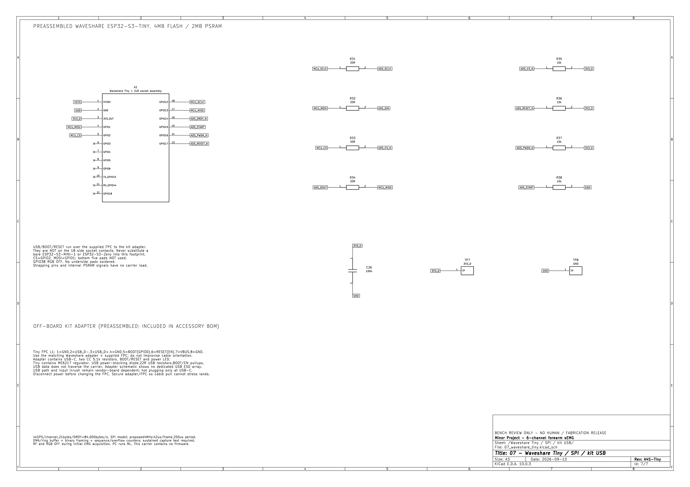

| Signal | ADS1296 Pin | ESP32-S3 GPIO | Header Contact | Function |
|:---|:---:|:---:|:---:|:---|
| **CS** | 39 | **GPIO 2** | Pin 5 | Chip Select (Active Low) |
| **MOSI (DIN)** | 43 | **GPIO 1** | Pin 4 | SPI Master-Out Slave-In |
| **SCLK** | 40 | **GPIO 12** | Pin 18 | SPI Serial Clock (up to 20 MHz) |
| **MISO (DOUT)** | 42 | **GPIO 13** | Pin 17 | SPI Master-In Slave-Out |
| **DRDY** | 47 | **GPIO 14** | Pin 16 | Data Ready Interrupt (Active Low) |
| **START** | 38 | **GPIO 15** | Pin 15 | Conversion Start Trigger |
| **PWDN_N** | 33 | **GPIO 16** | Pin 14 | Hardware Power-Down (Active Low) |
| **RESET_N** | 34 | **GPIO 17** | Pin 13 | Hardware Reset (Active Low) |

---

## 4. Interactive Graphical User Interface (GUI) Walkthrough

The Windows desktop application provides a complete control station for data acquisition, visual verification, machine learning model comparison, and real-time robotic teleoperation.

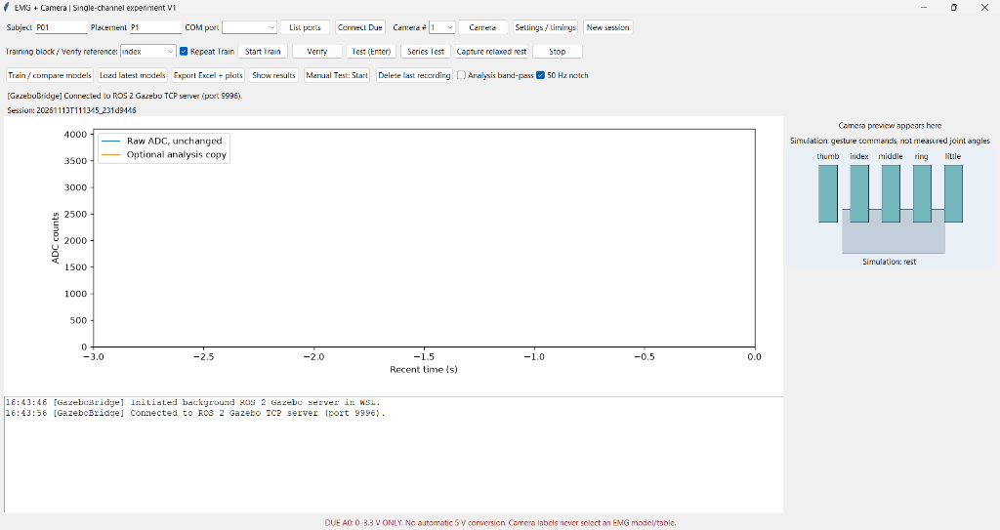

### Control & Button Breakdown

#### 1. Top Control Bar (Device Connection & Setup)
* **`Subject` (Text Entry)**: Sets the subject identifier (e.g. `P01`). All captured raw files, models, and metadata are saved under isolated subject directories (`data/<Subject>/`).
* **`Placement` (Text Entry)**: Sets the electrode placement index (e.g. `P1` to `P8`). Moving electrodes creates a new folder to prevent cross-placement data contamination.
* **`COM port` (Dropdown / Entry)**: Specifies the active serial COM port for the Arduino Due (e.g. `COM7`).
* **`List ports` (Button)**: Enumerates all active Windows serial devices, distinguishing Native USB endpoints from standard programming ports.
* **`Connect Due` (Button)**: Opens the serial connection, executes the safety handshake, queries firmware version, and starts the 2,000 Hz `EMG1` packet stream.
* **`Camera #` (Dropdown)**: Selects the Windows camera device index (0, 1, 2) to accommodate multiple webcams or DroidCam devices.
* **`Camera` (Toggle Button)**: Powers on/off the OpenCV webcam stream and initiates the MediaPipe Hand Landmarker visual tracking thread.
* **`Settings / timings` (Button)**: Opens the configuration modal to inspect or edit window lengths (default 1.2 s), pre/post-trigger intervals, filter poles, and rejection thresholds.
* **`New session` (Button)**: Generates a new session timestamp directory to maintain clean separation between recording blocks.

#### 2. Protocol & Acquisition Bar
* **`Training block / Verify reference` (Dropdown)**: Selects the active target gesture class: `rest`, `thumb`, `index`, `middle`, `ring`, `little`, `pinch`, `fist`.
* **`Repeat Train` (Checkbox)**: When checked, the application automatically rearms for the next repetition as soon as the previous trial is reviewed, enabling rapid batch training.
* **`Start Train` (Button)**: Arms the system for movement recording. Captures 1.0 s before and 1.5 s after the detected camera event. Opens an interactive review window where the user can inspect the raw EMG waveform, drag a 1.2 s selection window, and confirm the trial.
* **`Verify` (Button)**: Development verification mode. Extracts features and computes live model predictions against the chosen reference gesture to test model responsiveness.
* **`Test (Enter)` (Button)**: Official held-out test protocol. Captures a live movement, prompts the user to verify the camera label first, extracts features, runs autonomous EMG classification, and logs the result to `test_results.json`.
* **`Series Test` (Button)**: Multi-repetition test suite. Records multiple sequential movements, slides adjustable 1.2 s windows, and computes aggregate classification accuracy across repetitions.
* **`Capture relaxed rest` (Button)**: Manually captures baseline rest EMG with a neutral hand, guaranteeing unbiased resting baseline data.
* **`Stop` (Button)**: Immediately halts any running acquisition, disarms repeat training, or cancels ongoing data capture.

#### 3. Analysis, Export & Model Management
* **`Train / compare models` (Button)**: Opens the training manager. Fits all **21 model combinations** (Feature Sets A through G $\times$ Classifiers LDA, SVM, KNN) using 3-fold cross-validation on held-out trials, logs confusion matrices, and selects the champion model.
* **`Load latest models` (Button)**: Instantly reloads the most recently trained `.joblib` model pipeline and JSON validation parameters without retraining.
* **`Export Excel + plots` (Button)**: Exports a structured multi-sheet Excel workbook containing trial metadata, windowed feature matrices, model comparison tables, and generates matplotlib waveform figures.
* **`Show results` (Button)**: Displays a comprehensive modal showing held-out test accuracy, per-class recall, confusion matrices, macro F1 score, and coverage.
* **`Manual Test: Start` (Button)**: Runs a camera-free test session. Allows the user to click Start, perform any gesture, click Stop, slide the 1.2 s green inspection window over the signal, and view the predicted gesture.
* **`Delete last recording` (Button)**: Reversible deletion button that removes the most recent trial from disk if a false start, twitch, or improper movement occurred.
* **`Analysis band-pass` (Checkbox)**: Toggles an optional digital 4th-order Butterworth bandpass filter (70–450 Hz) for visual analysis without modifying the recorded raw ADC counts.
* **`50 Hz notch` (Checkbox)**: Enables/disables a digital 2nd-order IIR notch filter ($Q=30$) at 50 Hz to attenuate powerline hum in noisy environments.

#### 4. Live Visual Displays
* **Scrolling Oscilloscope**: Displays real-time EMG signals:
  * Blue trace: Raw, unadulterated ADC counts (`0 – 4095`).
  * Orange trace: Filtered analysis copy with DC bias removed.
* **Camera Preview Area**: Renders the live webcam feed overlaid with 21 MediaPipe hand landmarks, indicating whether each digit is bent (B), straight (S), or uncertain (U).
* **Virtual Robotic Hand Bar Indicators**: 5 vertical progress bars representing `thumb`, `index`, `middle`, `ring`, and `little` finger positions. Teleoperation commands dynamically flex the simulated bars and display active posture (e.g. `Simulation: rest`, `Simulation: index`).
* **Console Status Pane**: Displays real-time operational messages, including TCP bridge connection (`[GazeboBridge] Connected to ROS 2 Gazebo TCP server (port 9996)`).
* **Safety Advisory Banner**: Permanent hardware warning: `DUE A0: 0 - 3.3 V ONLY. No automatic 5 V conversion.`

---

## 5. Signal Processing, Feature Sets (A to G) & ML Models

### 5.1 Windowing & Preprocessing
* **Sample Rate**: $f_s = 2000\text{ Hz}$ ($T_s = 0.5\text{ ms}$).
* **Window Duration**: $W = 250\text{ ms}$ (500 samples).
* **Hop Interval**: $\Delta t = 50\text{ ms}$ (100 samples), creating a **75% overlap** between adjacent windows.
* **Windows per Trial**: For each reviewed 1.20 s trial, exactly **20 overlapping windows** are extracted.
* **Mean Centering**: Each window is centered by subtracting its mean ($x_i - \bar{x}$) to eliminate DC bias while preserving raw sample archives.

### 5.2 Mathematical Formulations for Feature Sets A to G

| Set | Code | Dimensions | Mathematical Formulation | Description |
|:---:|:---|:---:|:---|:---|
| **A** | `A_RMS` | 1 | $\text{RMS} = \sqrt{\frac{1}{N} \sum_{i=1}^N x_i^2}$ | Root Mean Square; proportional to muscle contraction force and motor unit recruitment. |
| **B** | `B_MAV` | 1 | $\text{MAV} = \frac{1}{N} \sum_{i=1}^N \|x_i\|$ | Mean Absolute Value; robust statistical measure of bio-signal amplitude. |
| **C** | `C_WL` | 1 | $\text{WL} = \sum_{i=1}^{N-1} \|x_{i+1} - x_i\|$ | Waveform Length; cumulative length of the waveform over the window, reflecting amplitude, frequency, and duration. |
| **D** | `D_TD4` | 4 | $[\text{MAV}, \text{WL}, \text{ZC}, \text{SSC}]^T$ | Hudgins' classic 4 time-domain features.<br/>• **Zero Crossings (ZC)**: Sign changes exceeding threshold $\epsilon = 3$ ADC counts.<br/>• **Slope Sign Changes (SSC)**: Extrema $(x_i - x_{i-1})(x_i - x_{i+1}) \ge \epsilon$. |
| **E** | `E_ALL5` | 5 | $[\text{RMS}, \text{MAV}, \text{WL}, \text{ZC}, \text{SSC}]^T$ | Extended time-domain feature vector combining amplitude power and frequency estimators. |
| **F** | `F_MAV_MAX_MIN` | 3 | $[\text{MAV}, \max(x), \min(x)]^T$ | Extreme amplitude features sensitive to burst transients during rapid finger flexion. |
| **G** | `G_TF8` | 8 | $P_k = \log\left(1 + \sum_{f \in B_k} \|X(f)\|^2\right)$ | **Time-Frequency Spectral Log Power**: Computes FFT power in 4 physiological sub-bands ($20–80$, $80–150$, $150–250$, $250–450\text{ Hz}$) separately over the **early half** ($0–125\text{ ms}$) and **late half** ($125–250\text{ ms}$) of the window ($4\times 2 = 8\text{ features}$). |

### 5.3 Machine Learning Classifiers
All models are evaluated within a `scikit-learn` pipeline with a fitted `StandardScaler` to normalize features:
1. **Linear Discriminant Analysis (LDA)**:
   * Solver: Least squares (`lsqr`) with automated Ledoit-Wolf shrinkage (`shrinkage='auto'`).
   * Finds a linear combination of features that maximizes the ratio of between-class variance to within-class variance.
2. **Support Vector Machine (SVM)**:
   * Kernel: Radial Basis Function (RBF) kernel: $K(x, x') = \exp(-\gamma \|x - x'\|^2)$.
   * Regularization parameter: $C = 1.0$, $\gamma = \text{'scale'}$.
3. **K-Nearest Neighbors (KNN)**:
   * Neighborhood size: $k = 5$.
   * Weighting: Inverse Euclidean distance ($w_i = 1 / d(x, x_i)$), giving closer training examples higher influence.

### 5.4 Decision Logic & Rejection Thresholding
* **Trial Prediction**: Derived from a majority vote across all 20 windows in the trial.
* **Window Agreement**: $\text{Agreement} = \frac{\text{Votes for winning class}}{20} \times 100\%$.
* **Rejection Gate**: A prediction is classified as **accepted** only if:
  1. The top vote count is strictly greater than all other classes (no ties).
  2. The window agreement is $\ge 60\%$ (at least 12 out of 20 windows agree).
* Trials falling below 60% agreement are logged as uncertain/rejected, preventing erratic or uncoordinated movements on the robotic hand.

---

## 6. ROS 2 & Gazebo Virtual Robotic Hand Simulation

The robotic simulation environment uses the **InMoov humanoid robotic hand** inside **ROS 2 Humble** and **Gazebo Classic 11**.

### Virtual Robotic Hand Joint Mapping
The simulated hand model features **17 active revolute joints** driven by effort controllers (`finger_position_controller`):

| Digit | Joint Names | Description | Flexion Target (rad) |
|:---|:---|:---|:---:|
| **Thumb** | `r_thumb1_joint`, `r_thumb_joint`, `r_thumb3_joint` | Abduction, metacarpal, interphalangeal flexion | `[0.60, 1.20, 1.20]` |
| **Index** | `r_index1_joint`, `r_index_joint`, `r_index3_joint` | Proximal, intermediate, distal phalanx curl | `[1.15, 1.25, 1.25]` |
| **Middle** | `r_middle1_joint`, `r_middle_joint`, `r_middle3_joint` | Proximal, intermediate, distal phalanx curl | `[1.15, 1.25, 1.25]` |
| **Ring** | `r_ring1_joint`, `r_ring_joint`, `r_ring3_joint`, `r_ring4_joint` | Splay (0.0) + proximal, intermediate, distal curl | `[0.0, 1.25, 1.25, 1.20]` |
| **Little** | `r_pinky1_joint`, `r_pinky_joint`, `r_pinky3_joint`, `r_pinky4_joint` | Splay (0.0) + proximal, intermediate, distal curl | `[0.0, 1.25, 1.25, 1.20]` |

### ROS 2 Bridge Architecture
The bridge server (`ros2_gazebo_server.py`) operates as a dual-threaded ROS 2 node inside WSL 2:
* **TCP Socket Listener**: Binds to `0.0.0.0:9996` and receives JSON gesture commands dispatched by the Windows GUI application.
* **ROS 2 Publishers**:
  * `/finger_position_controller/commands` (`std_msgs/msg/Float64MultiArray`): Dispatches 17-element floating-point joint trajectories directly to Gazebo `ros2_control`.
  * `/emg/gesture_command` (`std_msgs/msg/String`): Publishes textual gesture names for downstream logging or telemetry.
* **Watchdog Safety Timer**: If no new command is received within 2.0 seconds, the watchdog triggers an automatic return to `rest` (`0.0 rad` across all 17 joints), preventing the robotic hand from remaining frozen in a flexed state.

---

## 7. Experimental Results & Benchmark Performance

Comprehensive benchmarking was performed across 9 distinct experimental protocols evaluating gesture sets from 2 to 8 classes:

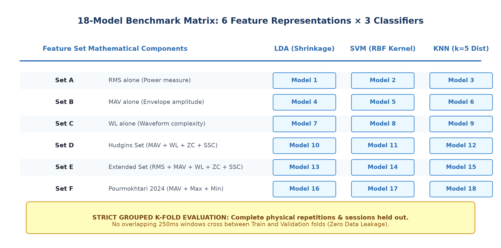
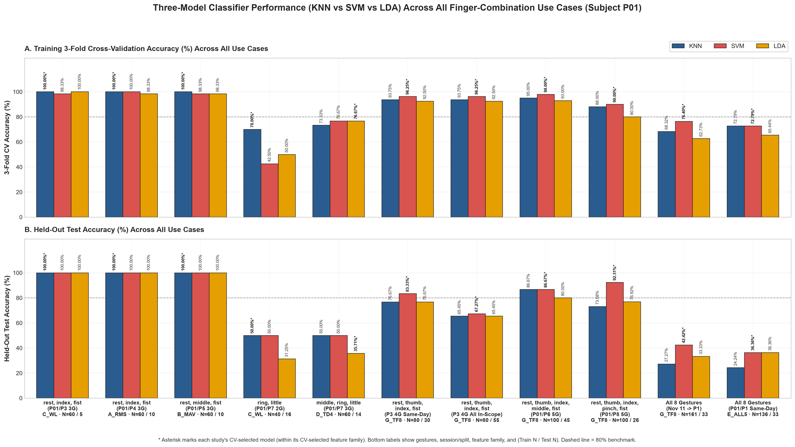

### Master Benchmark Evaluation Table

| Use Case | Gesture Set | Classes | Train ($N$) | Champion Model | 3-Fold CV Acc | Held-Out Test ($N$) | Test Acc (%) | Test Macro F1 | Coverage | Gazebo Match Rate |
|:---:|:---|:---:|:---:|:---|:---:|:---:|:---:|:---:|:---:|:---:|
| **1** | `rest, index, fist` | 3 | 60 | **`A_RMS__KNN`** | **100.0%** | 10 | **100.0%** | 1.0000 | 100.0% | **100.0%** (`10/10`) |
| **2** | `rest, middle, fist` | 3 | 60 | **`B_MAV__KNN`** | **100.0%** | 10 | **100.0%** | 1.0000 | 100.0% | **100.0%** (`10/10`) |
| **3** | `ring, little` | 2 | 40 | **`C_WL__KNN`** | **70.0%** | 16 | **50.0%** | 0.5000 | 43.8% | **81.2%** (`13/16`) |
| **4** | `middle, ring, little` | 3 | 60 | **`D_TD4__LDA`** | **76.7%** | 14 | **35.7%** | 0.3883 | 100.0% | **50.0%** (`7/14`) |
| **5** | `rest, thumb, index, middle, fist` | 5 | 100 | **`G_TF8__SVM`** | **98.0%** | 45 | **86.7%** | 0.8852 | 66.7% | **91.1%** (`41/45`) |
| **6** | `rest, thumb, index, pinch, fist` | 5 | 100 | **`G_TF8__SVM`** | **90.0%** | 26 | **92.3%** | 0.7379 | 50.0% | **96.2%** (`25/26`) |
| **7** | Full 8 Gestures (Cross-Day) | 8 | 161 | **`G_TF8__SVM`** | **76.4%** | 33 | **42.4%** | 0.2602 | 39.4% | **45.5%** (`15/33`) |
| **8** | `rest, index, fist` (Placement P3) | 3 | 60 | **`C_WL__KNN`** | **100.0%** | 5 | **100.0%** | 0.6667 | 100.0% | **100.0%** (`5/5`) |
| **9** | `rest, thumb, index, fist` (Placement P3) | 4 | 80 | **`G_TF8__SVM`** | **96.3%** | 30 | **83.3%** | 0.8765 | 63.3% | **90.0%** (`27/30`) |

### Waveform Characteristics
Mean window RMS waveforms ($\pm 1\text{ SD}$) across training trials demonstrate distinct physiological contraction envelopes across all 8 evaluated movements and fingers:

#### Individual Digits & Rest Baseline
| Rest Baseline | Thumb Flexion | Index Finger Flexion | Middle Finger Flexion |
|:---:|:---:|:---:|:---:|
| 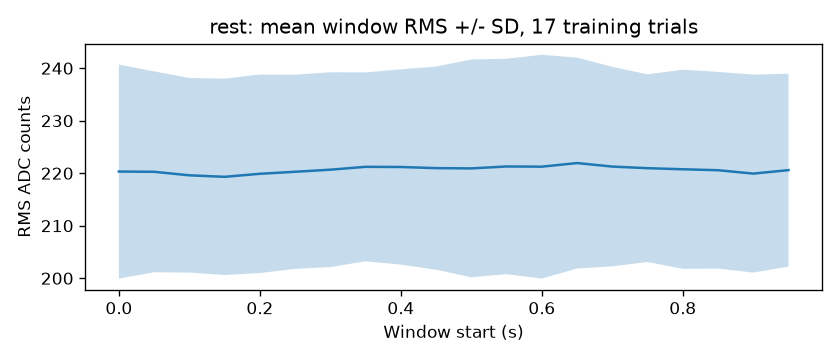 | 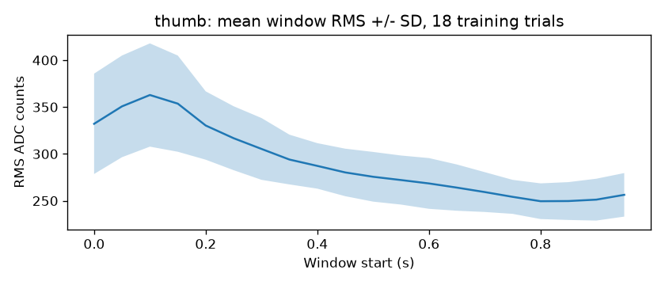 | 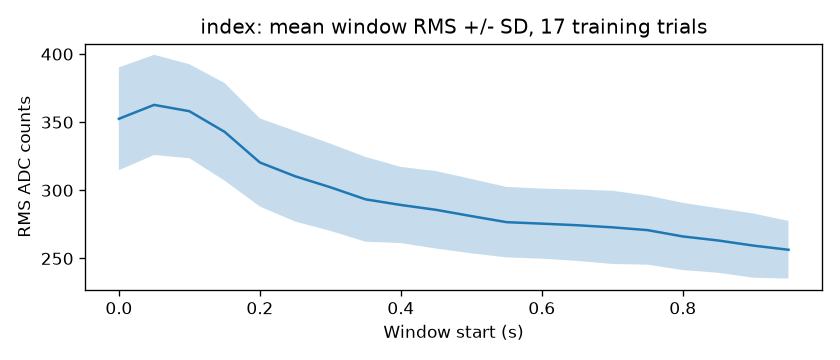 | 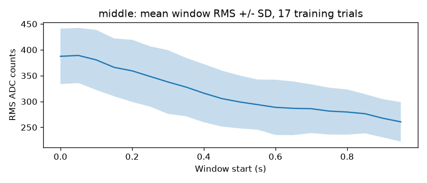 |

#### Central / Ulnar Digits & Compound Grasps
| Ring Finger Flexion | Little Finger Flexion | Precision Pinch | Power Fist |
|:---:|:---:|:---:|:---:|
| 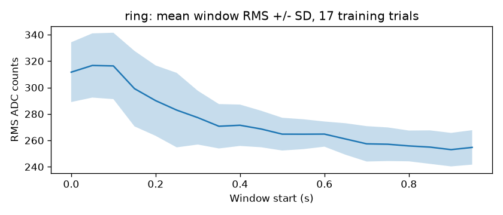 | 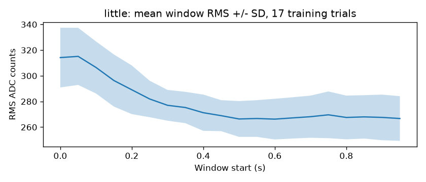 | 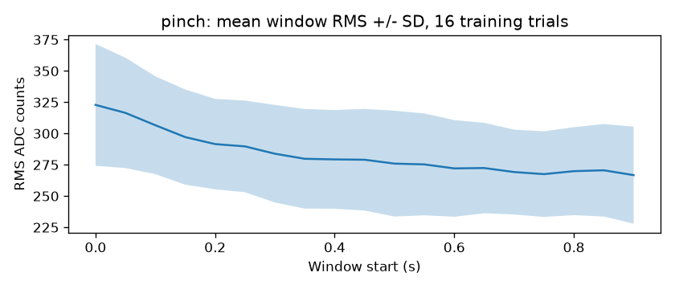 | 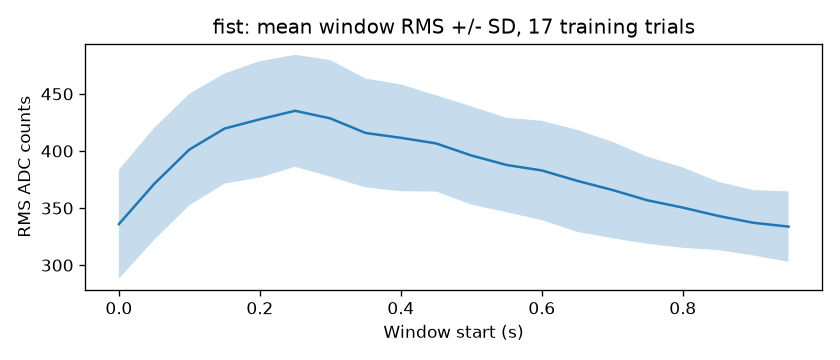 |

---

### 2D & 3D Feature Projections & Decision Boundaries

Principal Component Analysis (PCA) projections illustrate cluster separability, spatial cluster distributions, and non-linear decision boundaries for LDA, SVM, and KNN classifiers.

* **Sample 2D Decision Boundaries (Placement P3, 4 Gestures, TF8 Features)**:
  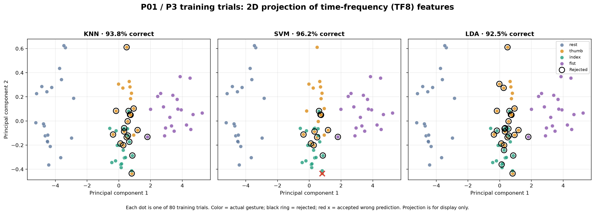
* **Sample 3D Decision Boundaries (Placement P3, 4 Gestures, TF8 Features)**:
  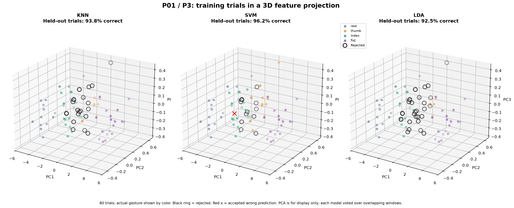

#### 📁 Training Results & Graphical Representations Directory

All graphical representation pictures (2D projections, 3D projections, and continuous probability gradient heatmaps) are organized into test-specific folders named by the exact fingers tested in the **[`results/training_results/`](results/training_results/)** archive:

| Test Folder | Tested Fingers / Movements | Gestures ($N$) | Champion Model | CV Accuracy | Test Accuracy |
|:---|:---|:---:|:---|:---:|:---:|
| [**`01_rest_index_fist`**](results/training_results/01_rest_index_fist/) | Rest, Index, Fist | 3 | `A_RMS__KNN` | **100.00%** | **100.00%** |
| [**`02_rest_middle_fist`**](results/training_results/02_rest_middle_fist/) | Rest, Middle, Fist | 3 | `B_MAV__KNN` | **100.00%** | **100.00%** |
| [**`03_ring_little`**](results/training_results/03_ring_little/) | Ring, Little (Hard Adjacent Pair) | 2 | `C_WL__KNN` / `F_MAV_MAX_MIN__SVM` | **70.00%** | **68.75%** (Best) |
| [**`04_middle_ring_little`**](results/training_results/04_middle_ring_little/) | Middle, Ring, Little (Adjacent Central/Ulnar) | 3 | `D_TD4__LDA` / `G_TF8__KNN` | **76.67%** | **92.86%** (Best) |
| [**`05_rest_thumb_index_middle_fist`**](results/training_results/05_rest_thumb_index_middle_fist/) | Rest, Thumb, Index, Middle, Fist | 5 | `G_TF8__SVM` | **98.00%** | **86.67%** |
| [**`06_rest_thumb_index_pinch_fist`**](results/training_results/06_rest_thumb_index_pinch_fist/) | Rest, Thumb, Index, Pinch, Fist | 5 | `G_TF8__SVM` | **90.00%** | **92.31%** |
| [**`07_all_8_gestures`**](results/training_results/07_all_8_gestures/) | All 8 Gestures (Cross-Day P1 Evaluation) | 8 | `G_TF8__SVM` | **76.40%** | **42.42%** |
| [**`08_rest_index_fist_p3`**](results/training_results/08_rest_index_fist_p3/) | Rest, Index, Fist (Placement P3 Baseline) | 3 | `C_WL__KNN` | **100.00%** | **100.00%** |
| [**`09_rest_thumb_index_fist_p3`**](results/training_results/09_rest_thumb_index_fist_p3/) | Rest, Thumb, Index, Fist (Placement P3 Multi-Session) | 4 | `G_TF8__SVM` / `F_MAV_MAX_MIN__KNN` | **96.25%** | **87.27%** (Best) |

Each subfolder contains high-resolution 2D scatter plots, 3D rotating perspective plots, and continuous decision boundary gradient heatmaps across all 3 classifiers.

---

## 8. Step-by-Step Guide: How to Make It Work

### Prerequisites
* **Operating System**: Windows 10/11 with **WSL 2** (Ubuntu 22.04 LTS).
* **Hardware**:
  * Arduino Due connected via micro-USB.
  * Muscle BioAmp Shield v0.3 plugged onto Arduino Due with Ag/AgCl electrodes.
  * Standard USB webcam.
* **Software**:
  * Python 3.12 (on Windows).
  * Arduino IDE (with Arduino SAM Boards Cortex-M3 core installed).
  * ROS 2 Humble Hawksbill and Gazebo Classic 11 (inside WSL 2).

---

### Step 1: Flash Arduino Due Firmware
1. Open the Arduino IDE.
2. Go to **Tools > Board > Boards Manager** and install **Arduino SAM Boards (32-bits ARM Cortex-M3)**.
3. Open `firmware/due_raw_emg/due_raw_emg.ino`.
4. Connect the Arduino Due via its **Programming Port**.
5. Select **Board: Arduino Due (Programming Port)** and click **Upload**.
6. Once uploaded, move the USB cable to the **Native USB port** (recommended for low-latency full-rate streaming).

---

### Step 2: Set Up Windows Python Environment
Open PowerShell in the project directory:

```powershell
cd src

# Run the automated setup script
.\setup.ps1
```

Or configure manually:
```powershell
py -3.12 -m venv .venv
.\.venv\Scripts\Activate.ps1
pip install --upgrade pip
pip install -r requirements.txt
```

Verify that `hand_landmarker.task` exists inside `src/`. If missing, download it from Google AI Edge:
```powershell
Invoke-WebRequest -Uri "https://storage.googleapis.com/mediapipe-models/hand_landmarker/hand_landmarker/float16/1/hand_landmarker.task" -OutFile "hand_landmarker.task"
```

---

### Step 3: Set Up ROS 2 & Gazebo in WSL 2
Open a WSL 2 terminal (Ubuntu 22.04 LTS):

```bash
# 1. Create or navigate to your ROS 2 workspace
mkdir -p ~/ros2_ws/src
cd ~/ros2_ws/src

# 2. Link the package
ln -s /mnt/c/path/to/emg-teleoperation-ros2/ros2/inmoov_hand_ros/src/inmoov_hand_description .

# 3. Build workspace
cd ~/ros2_ws
source /opt/ros/humble/setup.bash
colcon build --packages-select inmoov_hand_description --symlink-install
source install/setup.bash
```

---

### Step 4: Launch Gazebo & ROS 2 Bridge Server
Inside WSL 2:

**Terminal 1 (Gazebo Simulation)**:
```bash
source ~/ros2_ws/install/setup.bash
ros2 launch inmoov_hand_description gazebo.launch.py
```
*Gazebo Classic will launch displaying the upright InMoov right robotic hand.*

**Terminal 2 (TCP Bridge Server)**:
```bash
source ~/ros2_ws/install/setup.bash
ros2 run inmoov_hand_description ros2_gazebo_server.py
```
*The server will listen on `0.0.0.0:9996` for commands from the Windows GUI.*

---

### Step 5: Launch the Windows Desktop GUI
In PowerShell on Windows:

```powershell
cd src
.\launch.ps1
```

1. Click **List ports**, choose your Arduino Due COM port, and click **Connect Due**.
2. Select your camera index and click **Camera**.
3. Select a gesture (e.g. `index`), click **Start Train**, perform the gesture, review the EMG waveform, and save.
4. Record 15–20 trials per gesture, plus baseline `Capture relaxed rest`.
5. Click **Train / compare models** to fit all 21 models with 3-fold cross-validation.
6. Click **Test (Enter)** or **Manual Test** to classify movements and observe real-time teleoperation of the InMoov hand in Gazebo!

---

## 9. Relative Repositories, Documentation & References

### Third-Party Repositories & Toolkits
* **InMoov Humanoid Robot Project**: Gaël Langevin's open-source 3D printable humanoid robot platform ([InMoov Website](http://inmoov.fr/)).
* **Upside Down Labs BioAmp**: Open-source bio-potential amplifiers and hardware documentation ([BioAmp GitHub](https://github.com/upsidedownlabs)).
* **Google MediaPipe**: Fast, on-device perception pipelines for 21 3D hand landmarks ([MediaPipe Hand Landmarker](https://developers.google.com/edge/mediapipe/solutions/vision/hand_landmarker)).
* **ROS 2 Humble Hawksbill**: Long-Term Support robotics middleware ([ROS 2 Documentation](https://docs.ros.org/en/humble/)).
* **Gazebo Classic**: Multi-robot 3D physics simulator ([Gazebo Classic Documentation](https://classic.gazebosim.org/)).
* **scikit-learn**: Machine learning algorithms in Python ([scikit-learn Documentation](https://scikit-learn.org/)).

### Hardware Component Datasheets
* **Texas Instruments ADS1296**: *Low-Power, 6-Channel, 24-Bit Analog Front-End for Biopotential Measurements* (Literature Number: SBAS459K) ([TI ADS1296 Datasheet](https://www.ti.com/lit/ds/symlink/ads1296.pdf)).
* **Texas Instruments LP5907**: *250-mA, Ultra-Low-Noise, Low-IQ LDO Linear Regulator* (Literature Number: SNVS798N) ([TI LP5907 Datasheet](https://www.ti.com/lit/ds/symlink/lp5907.pdf)).
* **Texas Instruments TPD4E001**: *4-Channel Low-Capacitance ESD Protection Diode Array* (Literature Number: SLLSE14G) ([TI TPD4E001 Datasheet](https://www.ti.com/lit/ds/symlink/tpd4e001.pdf)).
* **Atmel SAM3X8E / Arduino Due**: *32-bit ARM Cortex-M3 Microcontroller Datasheet* ([Arduino Due Documentation](https://docs.arduino.cc/resources/datasheets/A000062-datasheet.pdf)).
* **Waveshare ESP32-S3-Tiny**: *Compact ESP32-S3 Development Board with FPC Adapter* ([Waveshare Wiki](https://www.waveshare.com/wiki/ESP32-S3-Tiny)).

### Key Academic Literature
* **Phan et al. (2026)**: *Acquisition and classification of a surface EMG dataset for finger movement*, IEEJ Trans. Electr. Electron. Eng., 21(11):1751–1755.
* **Pourmokhtari & Beigzadeh (2024)**: *Simple recognition of hand gestures using single-channel EMG signals*, Proc. Inst. Mech. Eng. H, 238(3):372–380.
* **Hudgins et al. (1993)**: *A new strategy for multifunction myoelectric control*, IEEE Trans. Biomed. Eng., 40(1):82–94.
* **Farina, Merletti & Enoka (2014)**: *The extraction of neural strategies from the surface EMG: An update*, J. Appl. Physiol., 117(11):1215–1230.
* **De Luca (1997)**: *The use of surface electromyography in biomechanics*, J. Appl. Biomech., 13(2):135–163.
* **Kumar, Arjunan & Singh (2013)**: *Towards identification of finger flexions using single channel surface electromyography*, J. Neuroeng. Rehabil., 10:50.
* **Woodward & Hargrove (2019)**: *Adapting myoelectric control in real-time using a virtual environment*, J. Neuroeng. Rehabil., 16:11.
