# Study 3: ring, little (2 Hard Adjacent Gestures)

- **Subject**: P01
- **Electrode Placement**: P7 / ring-little
- **Champion / Evaluated Model**: `C_WL__KNN (Selected) / F_MAV_MAX_MIN__SVM (Best Test)`
- **3-Fold Cross-Validation Accuracy**: 70.00% (28/40)
- **Held-Out Test Accuracy**: 50.00% (Selected) / 68.75% (Best Test)

---

## Graphical Representations & Decision Boundaries

### 2D Feature Projections & Decision Boundaries

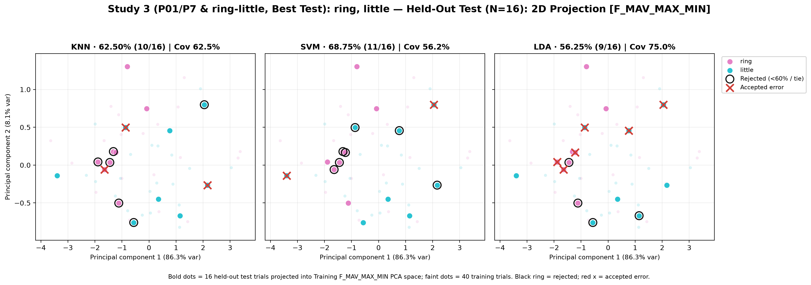

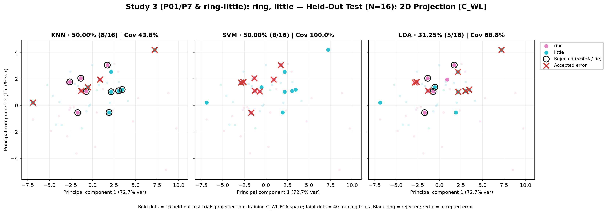

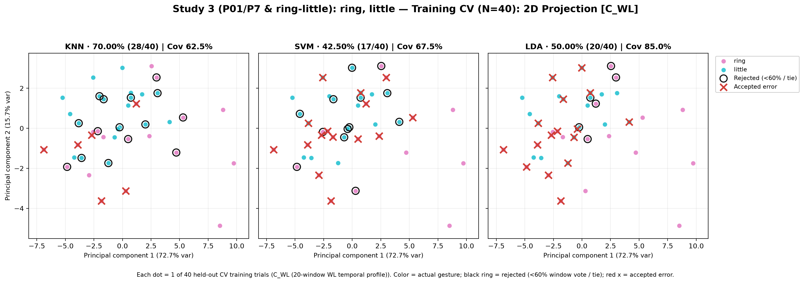

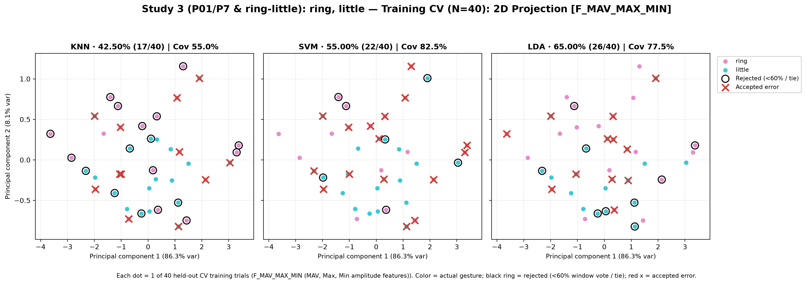

### 3D Feature Projections & Decision Boundaries

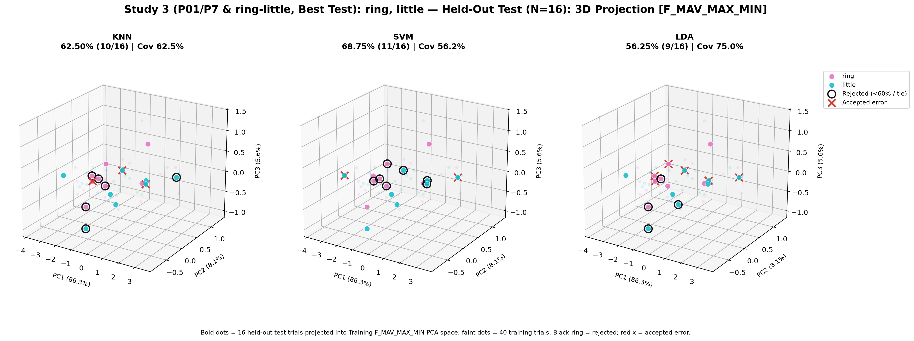

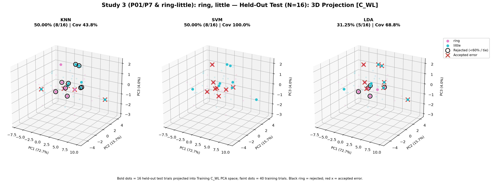

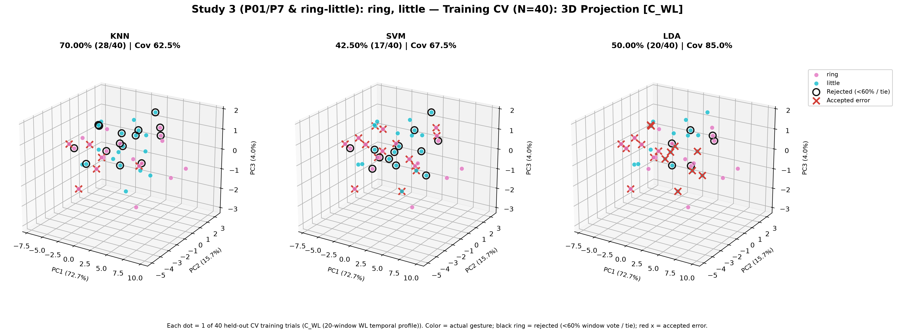

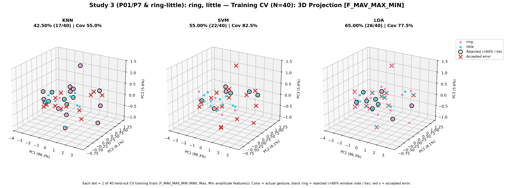

### Classifier Decision Boundary Gradient Heatmaps

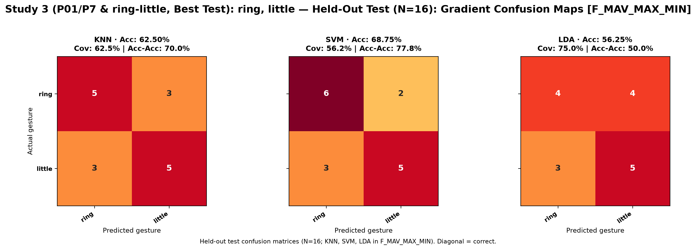

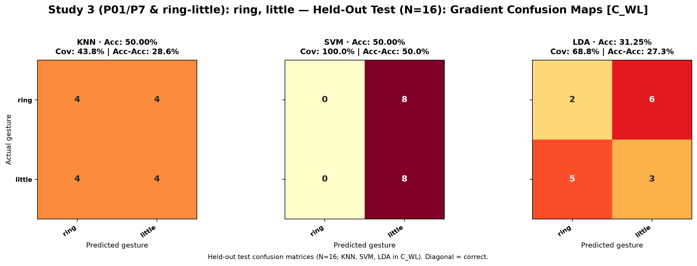

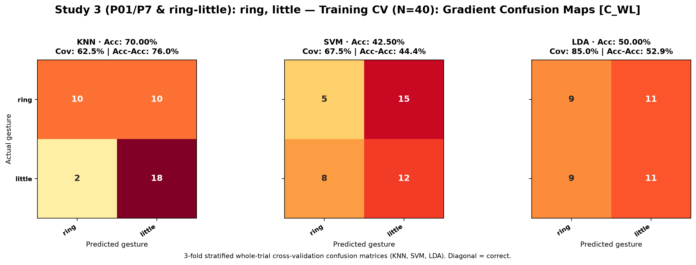

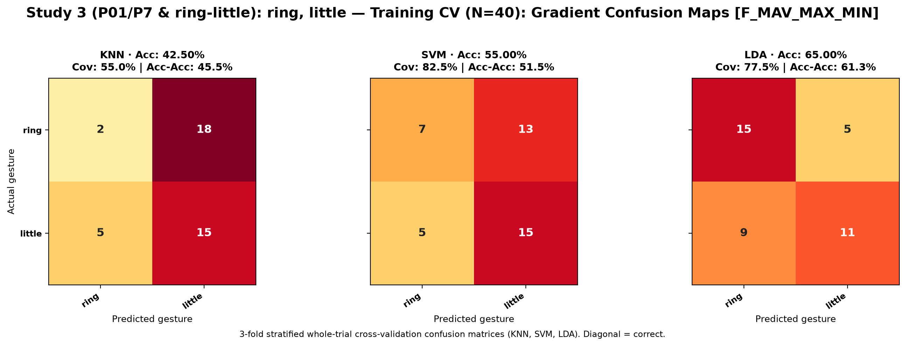
