# Study 4: middle, ring, little (3 Adjacent Central/Ulnar Digits)

- **Subject**: P01
- **Electrode Placement**: P7
- **Champion / Evaluated Model**: `D_TD4__LDA (Selected) / G_TF8__KNN (Best Test)`
- **3-Fold Cross-Validation Accuracy**: 76.67% (46/60)
- **Held-Out Test Accuracy**: 35.71% (Selected) / 92.86% (Best Test)

---

## Graphical Representations & Decision Boundaries

### 2D Feature Projections & Decision Boundaries

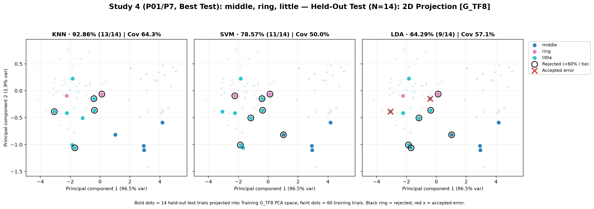

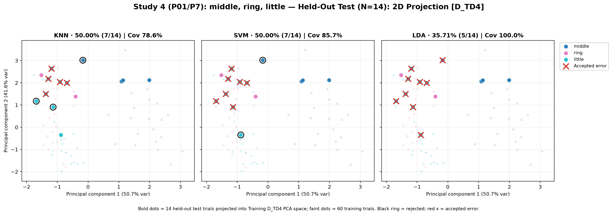

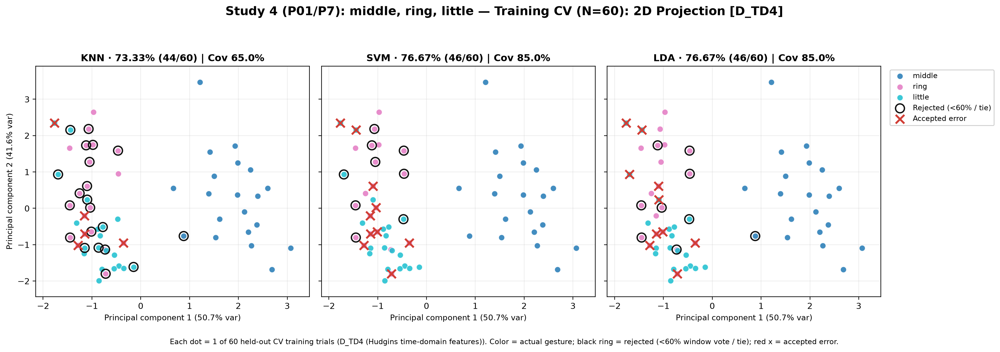

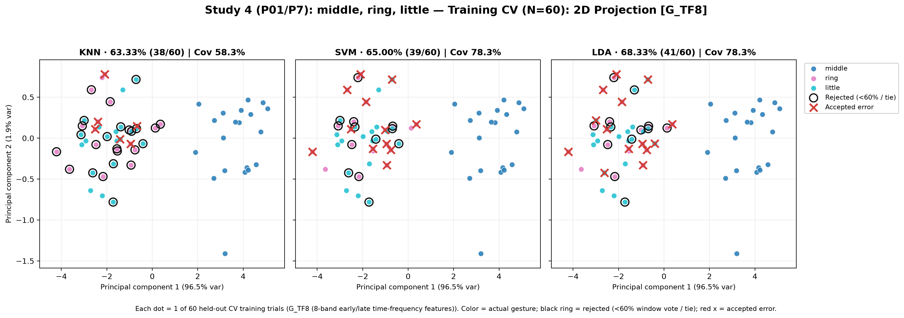

### 3D Feature Projections & Decision Boundaries

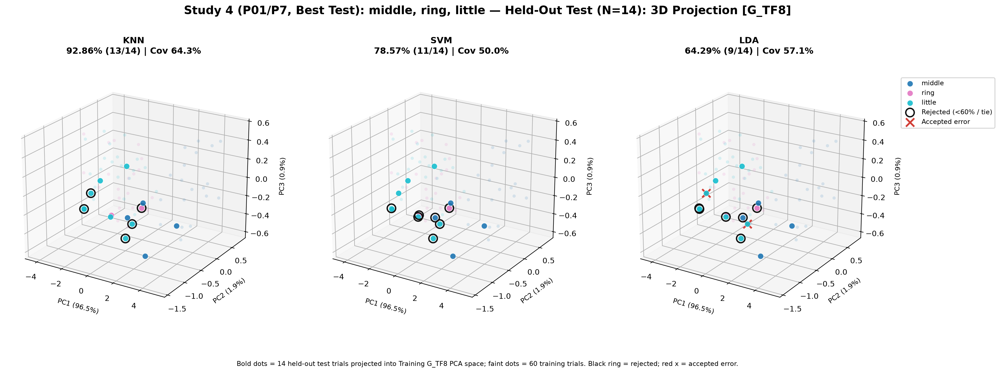

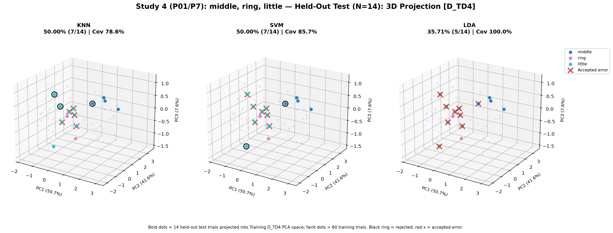

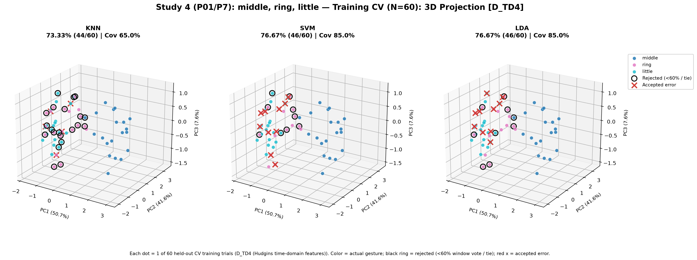

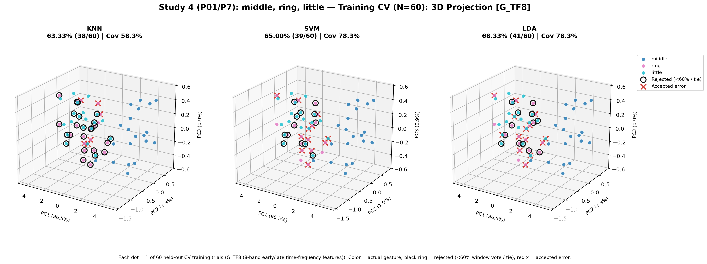

### Classifier Decision Boundary Gradient Heatmaps

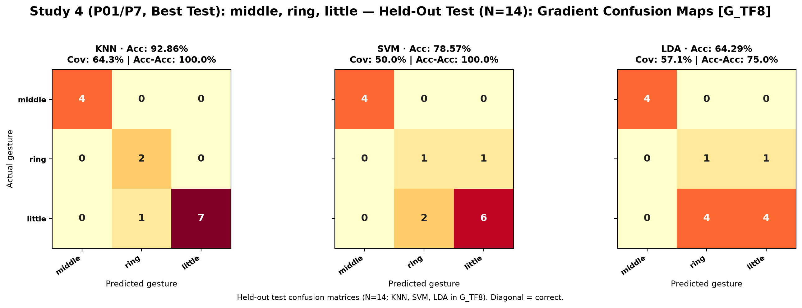

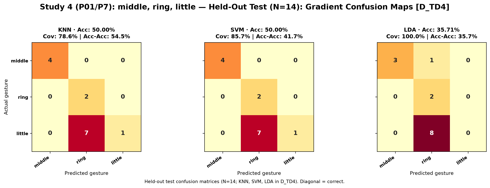

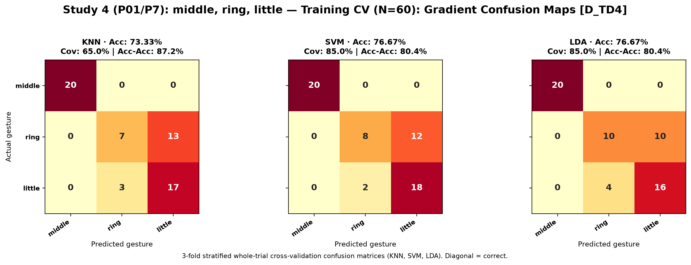

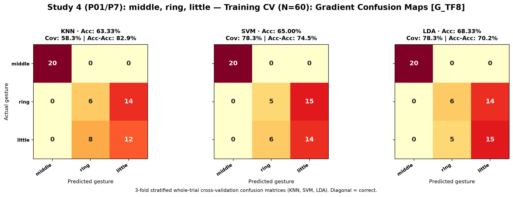
