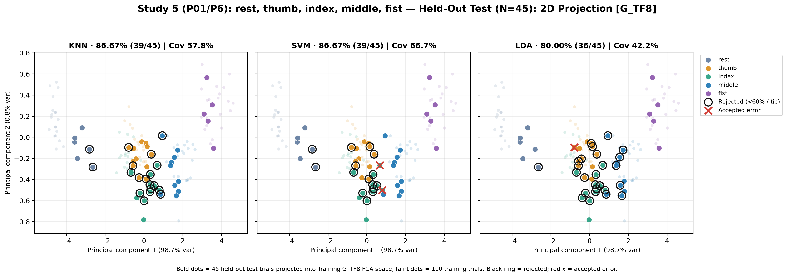
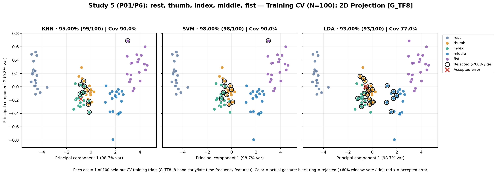
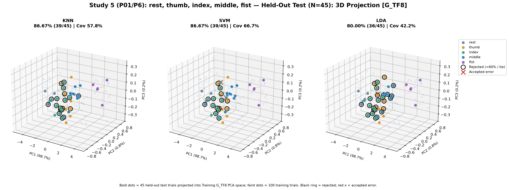
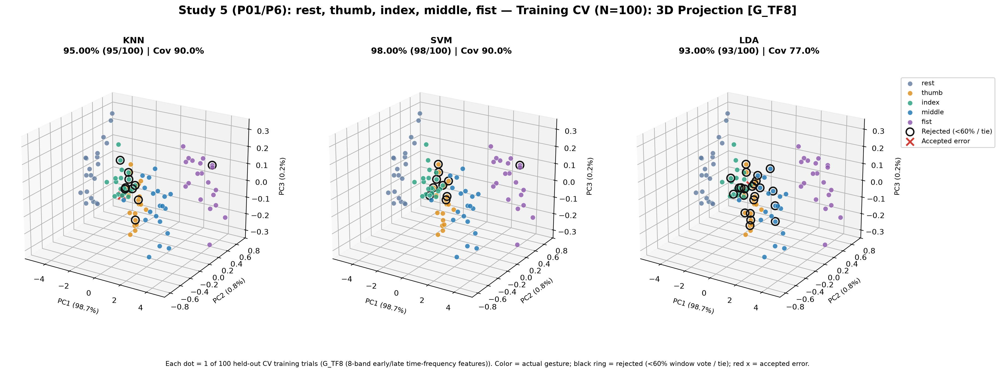
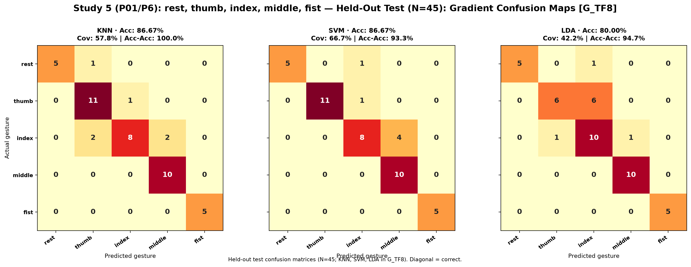
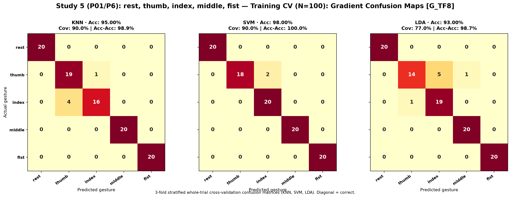

# Study 5: rest, thumb, index, middle, fist (5 Gestures)

- **Subject**: P01
- **Electrode Placement**: P6
- **Champion / Evaluated Model**: `G_TF8__SVM`
- **3-Fold Cross-Validation Accuracy**: 98.00% (98/100)
- **Held-Out Test Accuracy**: 86.67% (39/45)

---

## Graphical Representations & Decision Boundaries

### 2D Feature Projections & Decision Boundaries

### 3D Feature Projections & Decision Boundaries

### Classifier Decision Boundary Gradient Heatmaps

