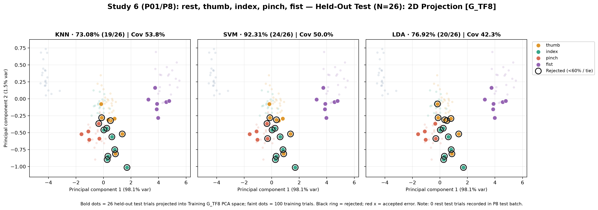
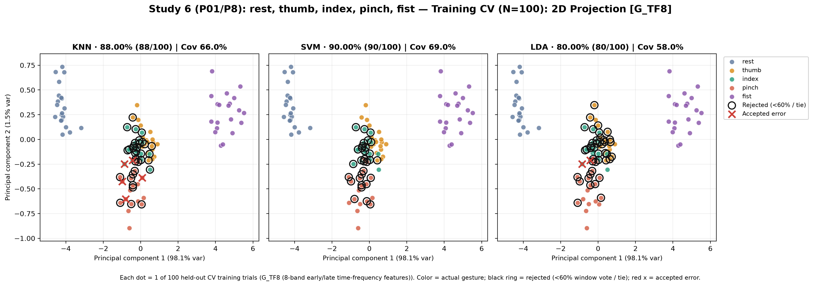
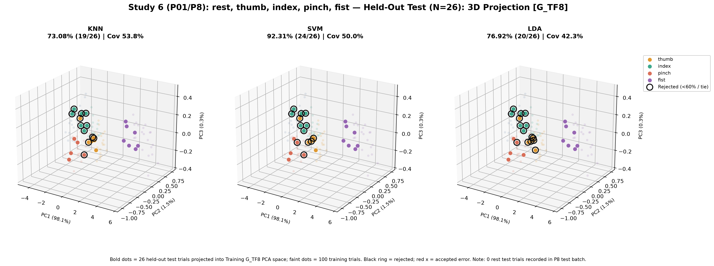
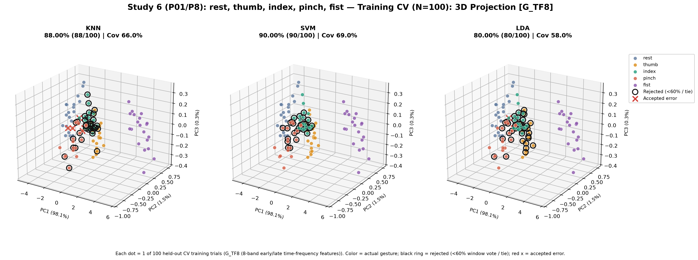
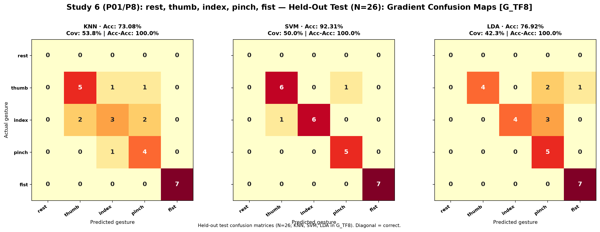
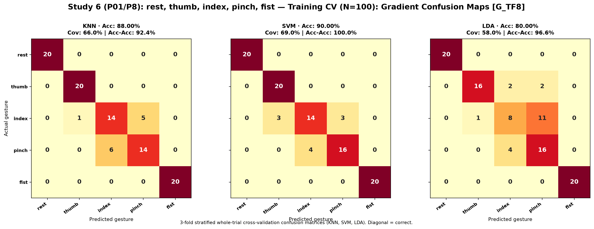

# Study 6: rest, thumb, index, pinch, fist (5 Gestures with Pinch)

- **Subject**: P01
- **Electrode Placement**: P8
- **Champion / Evaluated Model**: `G_TF8__SVM`
- **3-Fold Cross-Validation Accuracy**: 90.00% (90/100)
- **Held-Out Test Accuracy**: 92.31% (24/26)

---

## Graphical Representations & Decision Boundaries

### 2D Feature Projections & Decision Boundaries

### 3D Feature Projections & Decision Boundaries

### Classifier Decision Boundary Gradient Heatmaps

