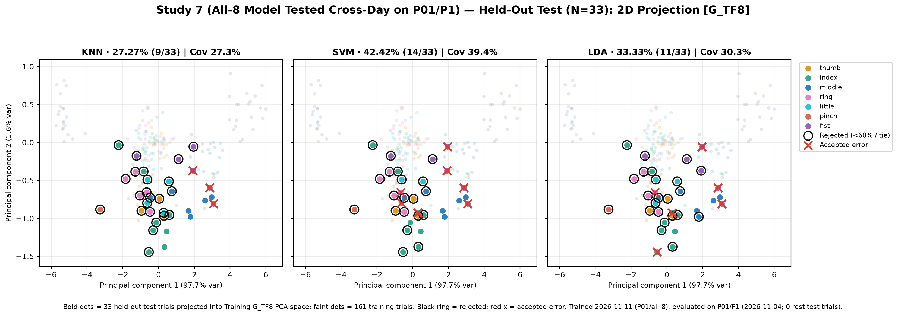
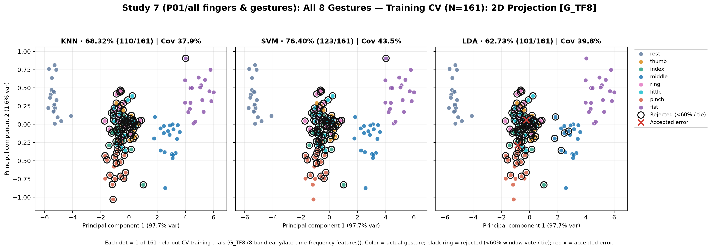
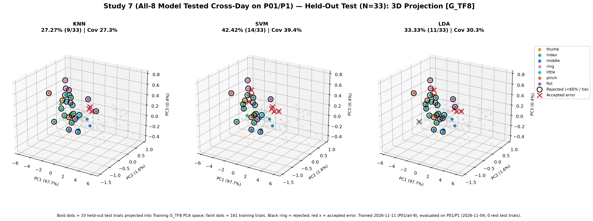
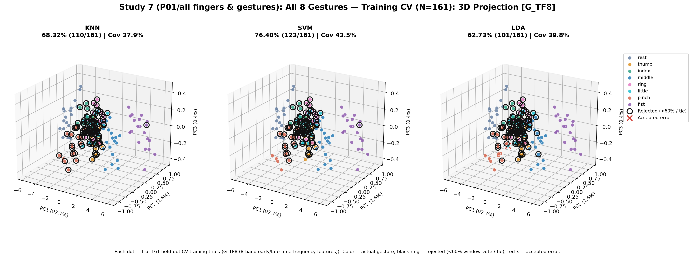
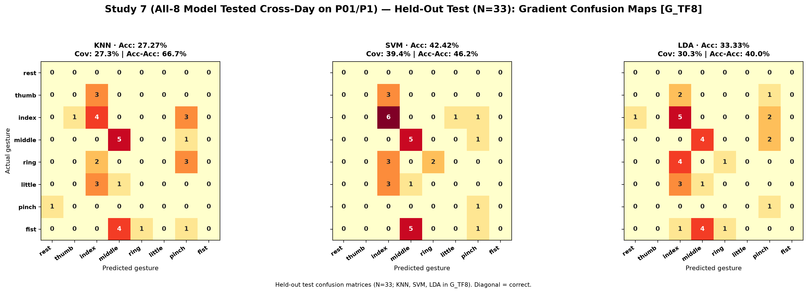
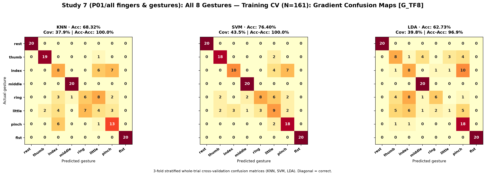

# Study 7: All 8 Gestures (rest, thumb, index, middle, ring, little, pinch, fist)

- **Subject**: P01
- **Electrode Placement**: Train: all fingers (P02/P3), Test: P01/P1 (Cross-Day)
- **Champion / Evaluated Model**: `G_TF8__SVM`
- **3-Fold Cross-Validation Accuracy**: 76.40% (123/161)
- **Held-Out Test Accuracy**: 42.42% (14/33)

---

## Graphical Representations & Decision Boundaries

### 2D Feature Projections & Decision Boundaries

### 3D Feature Projections & Decision Boundaries

### Classifier Decision Boundary Gradient Heatmaps

