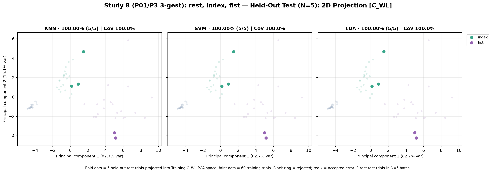
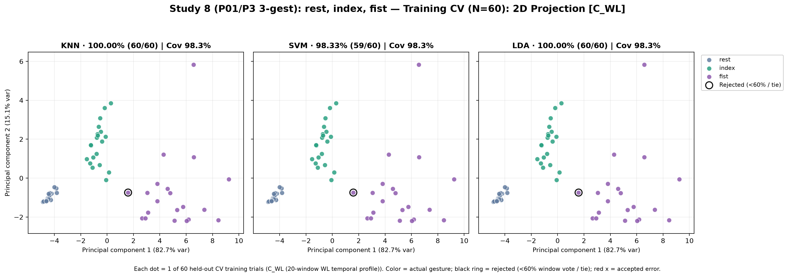
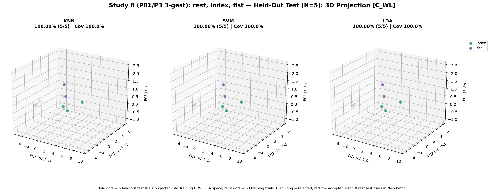
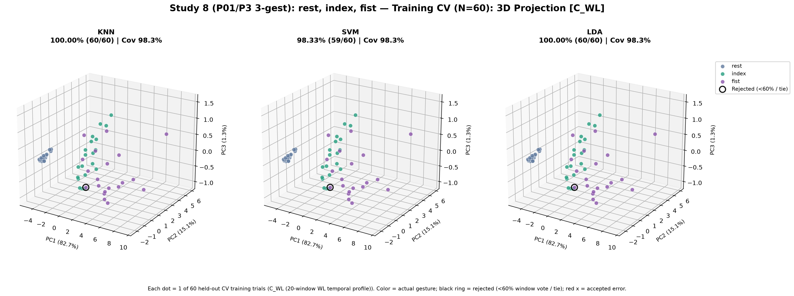
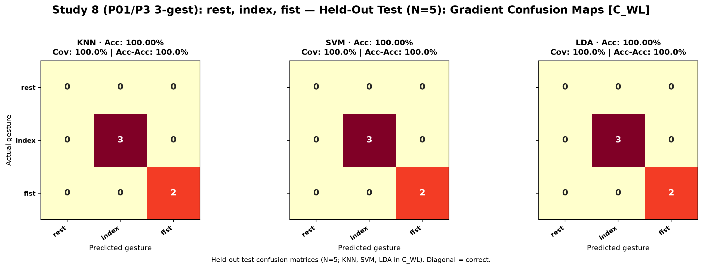
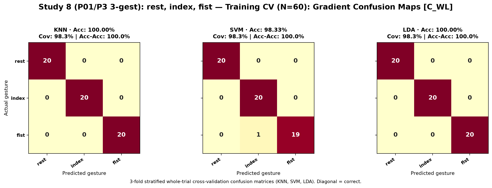

# Study 8: rest, index, fist (Placement P3 Baseline)

- **Subject**: P01
- **Electrode Placement**: P3
- **Champion / Evaluated Model**: `C_WL__KNN`
- **3-Fold Cross-Validation Accuracy**: 100.00% (60/60)
- **Held-Out Test Accuracy**: 100.00% (5/5)

---

## Graphical Representations & Decision Boundaries

### 2D Feature Projections & Decision Boundaries

### 3D Feature Projections & Decision Boundaries

### Classifier Decision Boundary Gradient Heatmaps

