# Study 9: rest, thumb, index, fist (Placement P3 Multi-Session)

- **Subject**: P01
- **Electrode Placement**: P3
- **Champion / Evaluated Model**: `G_TF8__SVM / F_MAV_MAX_MIN__KNN`
- **3-Fold Cross-Validation Accuracy**: 96.25% (77/80)
- **Held-Out Test Accuracy**: 83.33% (N=30) / 87.27% (N=55 Best Test)

---

## Graphical Representations & Decision Boundaries

### 2D Feature Projections & Decision Boundaries

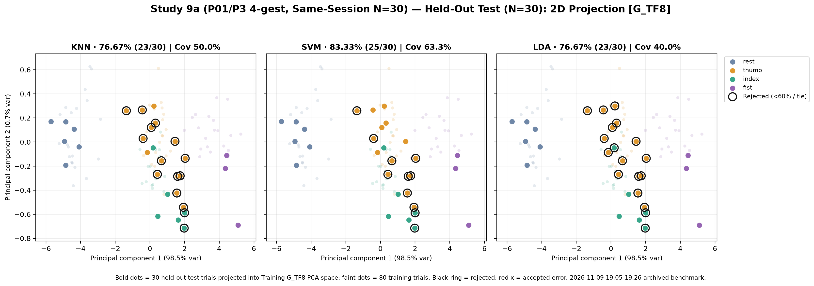

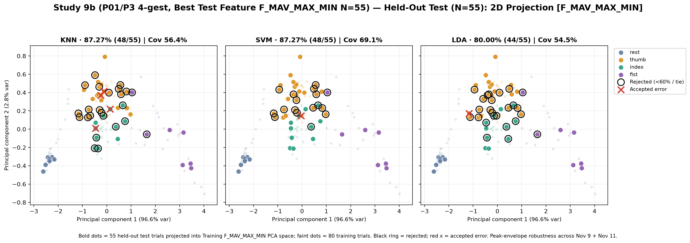

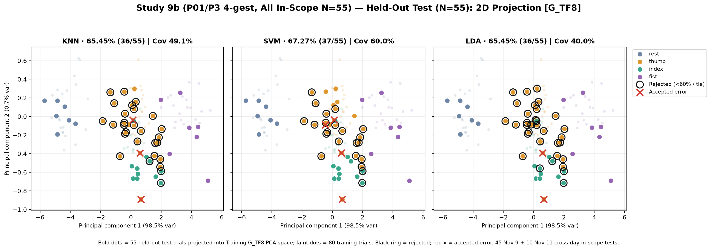

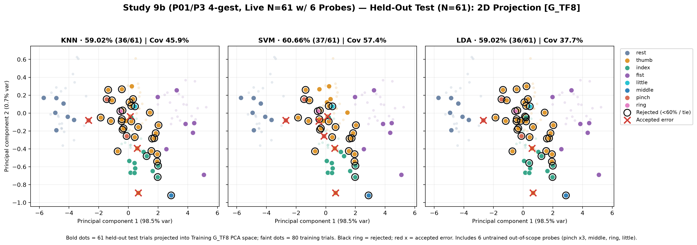

### 3D Feature Projections & Decision Boundaries

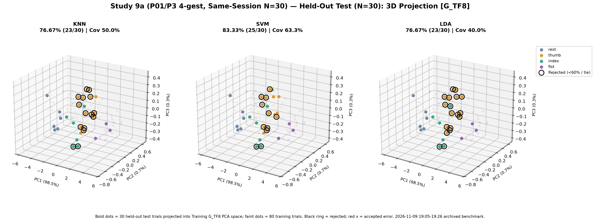

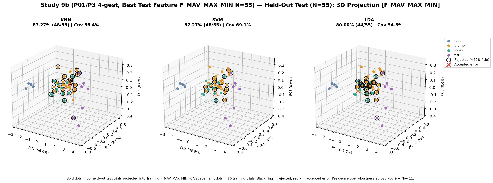

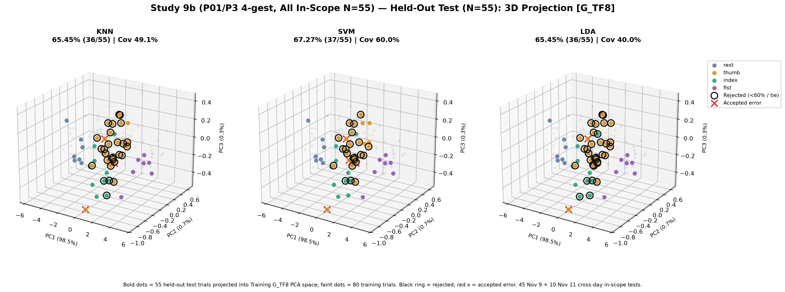

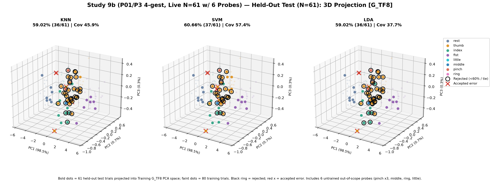

### Classifier Decision Boundary Gradient Heatmaps

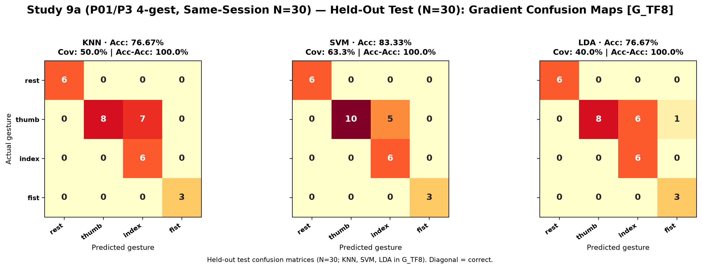

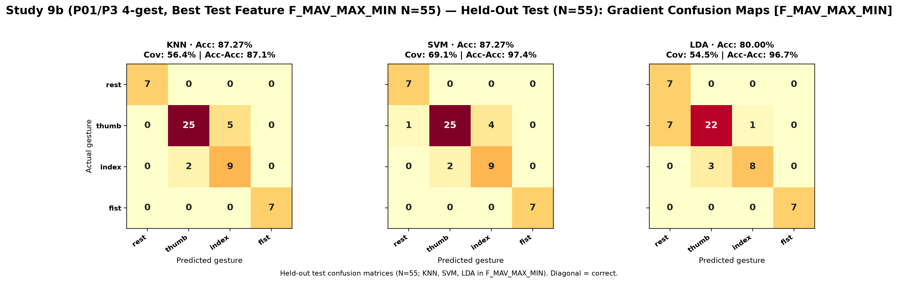

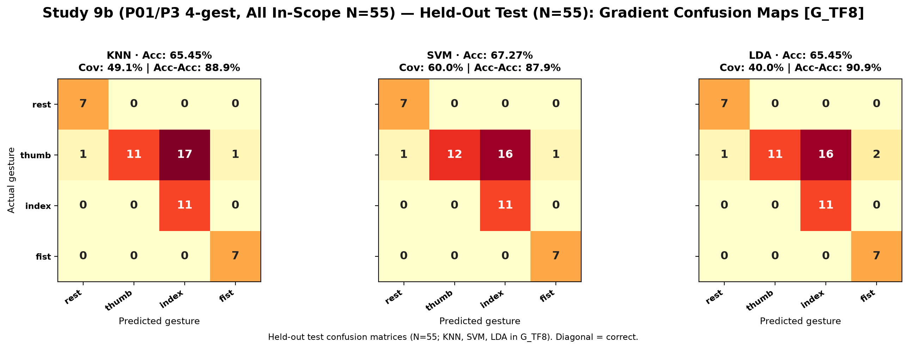

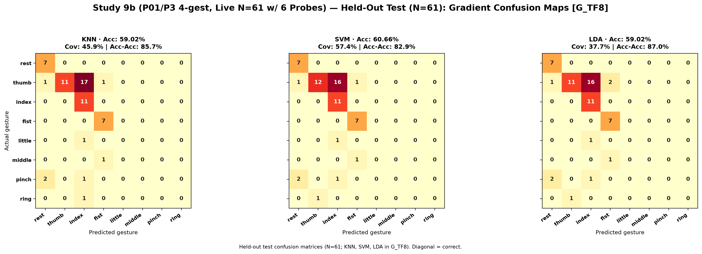
